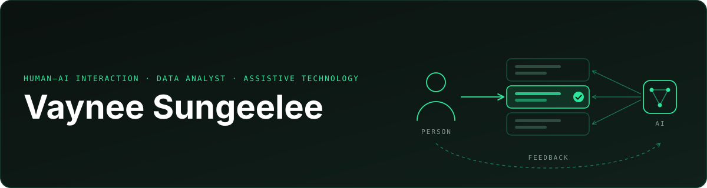

  

  <a href="https://vaynees.github.io">Portfolio</a> ·
  <a href="https://www.linkedin.com/in/vaynee-sungeelee/">LinkedIn</a> ·

## About me

I help teams find out whether an AI-enabled system works for the people who depend on it, with an interest in health, rehabilitation, and assistive technology. I design the evaluation, run it, and turn the results into recommendations a team can act on. 

I spent three years as a technical consultant on Salesforce projects for clients such as AXA and L'Oréal, working in Agile teams, followed by a three-year PhD in HCI, followed by a short collaboration on an interview study with artists, on how culture, tools and artistic practice have shifted over a decade of generative AI evolution. 

  

## Some questions I care about

**Evidence that an AI-enabled health or assistive product works for its users.**
Before a product reaches users, I help work out what to measure, how to run the study, and what the results say, so a team can decide what to do next.

**Personalisation that improves outcomes without leaving some users behind.**
A system that adapts to each person can still work well on average and badly for some people. I look at who benefits and who doesn't, so the adaptation helps everyone rather than only the typical user.

**Trust in intelligent systems.**
People use a system well only if they understand roughly what it does and when to rely on it. I study how users understand the system, whether that mental model is right, and how it changes the way they work with it.

**Data that decision-makers can use.**
Data only helps if people can find it, understand it and trust where it came from. I build the steps that take raw data to something clear and well documented that a team can explore and decide from.

## Selected work

### [Personalizing motor learning with machine learning](https://vaynees.github.io/projects/phd-poc-analysis/)
**Problem:** people don't all learn a motor skill at the same pace, so a fixed practice plan suits some learners and not others. 
**Approach:** I ran an experiment where an algorithm chose each learner's next exercise based on how they were doing, and compared it with random practice, which is a very good baseline for scheduling motor tasks. 
**Tools:** motion capture, Python, multi-armed bandit, statistical analysis. 
**Results:** Random schedules are hard to beat but learners on the adaptive curriculum executed movements more smoothly, and their performance was more even across the group.

### [Prosthesis adaptive training](https://vaynees.github.io/projects/prosthesis/)
**Problem:** a prosthesis controller relying on a classifier learns from the data it is trained on, so who guides the training (the user or the algorithm) changes how well it works. 
**Approach:** I compared different teaching strategies in a between-subjects study, using an EMG armband to record muscle signals. 
**Tools:** Thalmic Labs Myo armband, Python, scikit-learn (LDA classifier). 
**Results:** No strategy stands out for yielding the highest accuracy but the algorithm-led strategy gave the biggest gain in accuracy. It also left users with the best understanding of the controller, measured through the average number of false positives and negatives obtained at test time. Users training the classifier led to faster training at the start.

### [MoviesDB](https://github.com/vayneeS/MoviesDB)
**Problem:** IMDb's public data is millions of rows in flat files, which is not not great to explore as it is. 
**Approach:** As part of a collaboration, I designed the relational database and wrote the SQL and Python scripts that load and clean the data, all run with Docker. There is also a graph database and a Streamlit app on top, which uses CSV files cleaned and transformed using SQL. 
**Tools:** Python, SQL, Docker, Neo4j, Streamlit. 
**Results:** a working app where you can browse movies and the people behind them as a graph.

## Toolbox

Python (pandas, NumPy, scikit-learn, Jupyter) · SQL · Docker · n8n · Taguette · Power BI (PL-300 certified)
